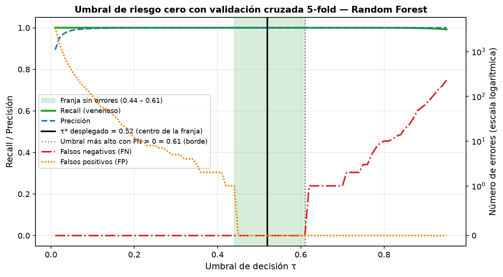

# Sistema Inteligente de Clasificación Micológica: Predicción Explicable de la Toxicidad en Hongos con Aprendizaje Automático Orientado a Riesgo Cero

[Nombre Apellido 1], [Nombre Apellido 2] 
<em>Programa de Ingeniería de Software, Facultad de Ingeniería</em> 
<em>[Universidad], [Ciudad], Colombia</em> 
[correo1@institucion.edu.co], [correo2@institucion.edu.co]

---

<em>Resumen</em>—Confundir un hongo venenoso con uno comestible es un error potencialmente mortal, por lo que un clasificador de toxicidad no debe evaluarse solo por su exactitud sino por su número de falsos negativos (FN). Este trabajo presenta un sistema de clasificación binaria construido sobre el <em>Secondary Mushroom Dataset</em> (61.069 registros, 20 características). Se compararon cuatro modelos —Regresión Logística, Random Forest, XGBoost y Perceptrón Multicapa (MLP)— con el mismo preprocesamiento (128 características codificadas) y una partición estratificada 70/15/15. El modelo se seleccionó con un criterio jerárquico orientado al riesgo: FN = 0, luego F1, ROC-AUC y tiempo de entrenamiento. En el conjunto de prueba (9.161 registros), Random Forest y MLP alcanzaron exactitud, precisión y sensibilidad del 100 %; XGBoost obtuvo 99,4 % de exactitud con 44 FN y la Regresión Logística 86,7 % con 619 FN. Se eligió Random Forest y su umbral de decisión se calibró con validación cruzada estratificada de cinco particiones. Las probabilidades fuera de partición separan las clases con una franja vacía entre 0,44 y 0,61, y el umbral se fijó en su centro, τ* = 0,52, con un margen de al menos 0,08 hacia cada tipo de error; el umbral de 0,67 obtenido con un único split, el mayor que conservaba FN = 0, dejaba pasar un hongo venenoso en una partición. La simulación de resultados con el modelo desplegado confirmó FN = 0 y FP = 0 en prueba, donde la franja vacía va de 0,34 a 0,67. El sistema se desplegó en una aplicación con explicación exacta de cada dictamen. Se discute que el rendimiento perfecto es propio de un conjunto de datos simulado.

<em>Palabras clave</em>—clasificación de hongos, toxicidad, Random Forest, XGBoost, perceptrón multicapa, aprendizaje sensible al costo, umbral de decisión, inteligencia artificial explicable.

<em>Abstract</em>—Mistaking a poisonous mushroom for an edible one is a potentially fatal error, so a toxicity classifier must be judged by its number of false negatives (FN) rather than by accuracy alone. This paper presents a binary classification system built on the Secondary Mushroom Dataset (61,069 records, 20 features). Four models were compared —Logistic Regression, Random Forest, XGBoost and a Multilayer Perceptron (MLP)— under the same preprocessing (128 encoded features) and a stratified 70/15/15 split. The model was selected with a risk-oriented hierarchical criterion: FN = 0, then F1, ROC-AUC and training time. On the test set (9,161 records), Random Forest and MLP reached 100 % accuracy, precision and recall; XGBoost reached 99.4 % accuracy with 44 FN and Logistic Regression 86.7 % with 619 FN. Random Forest was chosen and its decision threshold was calibrated with five-fold stratified cross-validation. The out-of-fold probabilities separate the classes with an empty band between 0.44 and 0.61, and the threshold was set at its centre, τ* = 0.52, with a margin of at least 0.08 to either type of error; the 0.67 threshold obtained from a single split, the highest one that kept FN = 0, let one poisonous mushroom through in one fold. A simulation of results with the deployed model confirmed FN = 0 and FP = 0 on the test set, where the empty band spans 0.34 to 0.67. The system was deployed in an application that gives an exact explanation of each verdict. We discuss that the perfect performance is specific to a simulated dataset.

<em>Index Terms</em>—mushroom classification, toxicity, Random Forest, XGBoost, multilayer perceptron, cost-sensitive learning, decision threshold, explainable artificial intelligence.

## I. Introducción

La recolección de hongos silvestres implica un riesgo crítico: muchas especies comestibles y tóxicas comparten rasgos morfológicos casi idénticos, y la identificación basada únicamente en la observación humana tiene un margen de error alto. Desde el punto de vista computacional, estimar la toxicidad a partir de variables numéricas y categóricas es un problema de clasificación binaria no lineal con **costos asimétricos**: un falso positivo (descartar un hongo comestible) solo desperdicia un ejemplar, mientras que un falso negativo (declarar comestible un hongo venenoso) puede causar una intoxicación grave.

La mayoría de los ejercicios de clasificación en este dominio entrenan modelos para maximizar la exactitud y usan el conjunto clásico de UCI de 1987 [2], limitado a 8.124 instancias de 23 especies. Este proyecto parte de una pregunta distinta: *¿de qué manera el análisis de características morfológicas y ambientales mediante modelos explicables de aprendizaje automático permite predecir la toxicidad de los hongos silvestres minimizando el riesgo de falsos negativos?*

### A. Objetivos

**Objetivo general.** Desarrollar un sistema explicable de aprendizaje automático que prediga la toxicidad de los hongos a partir de sus características morfológicas y ambientales, minimizando los falsos negativos.

**Objetivos específicos.**

- **OE1.** Construir y auditar un conjunto de datos balanceado de más de 35.000 registros.
- **OE2.** Entrenar y comparar cuatro modelos de aprendizaje automático bajo un mismo protocolo, con métricas de evaluación orientadas al riesgo.
- **OE3.** Seleccionar el mejor modelo y calibrar su umbral de decisión de modo que no produzca falsos negativos (FN = 0).
- **OE4.** Explicar las predicciones del modelo, tanto de forma global como para cada ejemplar.
- **OE5.** Implementar una aplicación trazable y reproducible con precisión superior al 95 %.

### B. Contribuciones

Las contribuciones del trabajo son: 1) una comparación controlada de cuatro familias de modelos sobre el *Secondary Mushroom Dataset* [1], [3]; 2) una metodología de selección y de calibración de umbral condicionada a FN = 0 y verificada con validación cruzada; 3) una simulación de resultados con el modelo desplegado que cuantifica el margen de seguridad del umbral; y 4) una aplicación que descompone de forma exacta cada probabilidad en aportes por variable.

El resto del documento se organiza así: la Sección II resume los trabajos relacionados; la III describe la metodología; la IV presenta la simulación de resultados; la V los resultados y su discusión; las Secciones VI y VII recogen las conclusiones y los trabajos futuros.

## II. Trabajos relacionados

**Datos.** El *Mushroom Data Set* de Schlimmer [2] ha sido durante décadas un banco de pruebas para algoritmos de inducción de reglas y árboles, pero es pequeño, puramente categórico y casi trivialmente separable. Wagner, Heider y Hattab [1] construyeron un conjunto primario de 173 especies a partir de la guía de Hardin [4] y, a partir de él, simularon el *Secondary Mushroom Dataset* [3]: 353 ejemplares hipotéticos por especie, con tres variables métricas y diecisiete nominales. Los propios autores reportan que clasificadores estándar, en particular Random Forest, alcanzan un rendimiento casi perfecto sobre los datos simulados.

**Modelos para datos tabulares.** Los ensambles de árboles —Random Forest [5] por *bagging* y XGBoost [6] por *boosting*— siguen siendo la referencia en datos tabulares de tamaño medio; estudios comparativos recientes muestran que igualan o superan a las redes profundas en este tipo de datos [14], [15]. La Regresión Logística [17] se mantiene como línea base interpretable, y el Perceptrón Multicapa entrenado por retropropagación [12] con el optimizador Adam [11] representa a la familia neuronal.

**Aprendizaje sensible al costo.** Elkan [10] demostró que, cuando los costos de error son asimétricos, la decisión óptima se obtiene desplazando el umbral aplicado a la probabilidad estimada, sin reentrenar el modelo. Esta idea fundamenta la calibración del umbral de este trabajo.

**Explicabilidad.** SHAP [7], con su variante eficiente para árboles [13], y LIME [8] son los métodos de atribución más extendidos. Para bosques existe además la descomposición por contribuciones de camino de Saabas [16], exacta y sin dependencias externas.

**Vacío abordado.** Los trabajos anteriores evalúan mayoritariamente la exactitud. Este proyecto integra la selección de modelo y de umbral condicionadas a FN = 0 con una explicación verificable de cada dictamen.

## III. Metodología

### A. Conjunto de datos

Se utilizó `secondary_data.csv` [1], [3]: 61.069 registros y 21 columnas (3 variables métricas —diámetro del sombrero, alto y ancho del tallo—, 17 nominales y la clase). La variable objetivo se codificó como $Y = 1$ (venenoso, clase de riesgo) y $Y = 0$ (comestible). Los autores del conjunto fusionaron las especies de comestibilidad desconocida con la clase venenosa, criterio conservador coherente con el objetivo del proyecto. La Tabla I muestra el balance de clases; la razón de desbalance es 1,25 : 1, por lo que no se aplicó sobremuestreo.

TABLA I Balance de clases

| Clase | Registros | Porcentaje |
|---|---|---|
| Venenoso (`p`) | 33.888 | 55,49 % |
| Comestible (`e`) | 27.181 | 44,51 % |

La auditoría de calidad (`dataset_inspector.py`) arrojó tres hallazgos:

- **Valores nulos.** Nueve columnas categóricas tienen faltantes, cinco de ellas por encima del 60 % (por ejemplo, `veil-type` 94,8 %). En micología la ausencia es informativa, así que no se eliminaron filas ni columnas: se imputó la categoría explícita `"missing"`.
- **Duplicados exactos.** 146 (0,24 %), conservados por ser esperables en una simulación de 353 ejemplares por especie.
- **Valores atípicos (IQR).** Entre 3,2 % y 5,2 % en las variables métricas, conservados por representar variabilidad biológica.

### B. Preprocesamiento y partición

Los datos se dividieron de forma estratificada en entrenamiento (42.748 registros, 70 %), validación (9.160, 15 %) y prueba (9.161, 15 %) con semilla 42. Las tres variables numéricas se imputaron por mediana y se estandarizaron:

$$x' = \frac{x - \mu}{\sigma}$$

donde $\mu$ y $\sigma$ son la media y la desviación estándar de la variable en entrenamiento. Las 17 categóricas se imputaron con `"missing"` y se codificaron con One-Hot. El resultado es un vector $\mathbf{x} \in \mathbb{R}^{128}$. El preprocesador se ajustó únicamente con el conjunto de entrenamiento para evitar fuga de información [18].

### C. Modelos candidatos

Se eligieron cuatro modelos de familias de hipótesis distintas (Tabla II), con configuraciones estándar y sin búsqueda de hiperparámetros, para que la comparación refleje la capacidad de cada familia y no el esfuerzo de ajuste.

TABLA II Modelos y configuración

| Modelo | Familia | Configuración |
|---|---|---|
| Regresión Logística (RL) | Lineal | Regularización $L_2$, 1.000 iteraciones |
| Random Forest (RF) | *Bagging* | 100 árboles, Gini |
| XGBoost (XGB) | *Boosting* | 100 árboles, profundidad 6, tasa 0,1 |
| MLP | Red neuronal | Capas (64, 32), ReLU, Adam |

*1) Regresión Logística:* modela la probabilidad de toxicidad con la función sigmoide sobre un predictor lineal:

$$P(Y=1 \mid \mathbf{x}) = \sigma(z) = \frac{1}{1 + e^{-z}}, \quad z = \mathbf{w}^T\mathbf{x} + w_0$$

y ajusta los pesos $\mathbf{w}$ minimizando la entropía cruzada binaria con penalización $L_2$:

$$\begin{aligned} J(\mathbf{w}) = &-\frac{1}{N} \sum_{i=1}^N \big[ y_i \ln \hat{p}_i + (1 - y_i) \ln(1 - \hat{p}_i) \big] \\ &+ \frac{1}{2C} \|\mathbf{w}\|_2^2 \end{aligned}$$

donde $\hat{p}_i$ es la probabilidad estimada para el registro $i$ y $C$ el inverso de la fuerza de regularización.

*2) Random Forest:* cada árbol divide sus nodos maximizando la reducción de la impureza de Gini del nodo $t$,

$$I_G(t) = 1 - \sum_{k=0}^{1} p_k(t)^2$$

donde $p_k(t)$ es la proporción de la clase $k$ en el nodo. El bosque promedia las probabilidades de sus $B$ árboles [5]:

$$\hat{P}(Y=1 \mid \mathbf{x}) = \frac{1}{B} \sum_{b=1}^{B} P_b(Y=1 \mid \mathbf{x})$$

*3) XGBoost:* construye un modelo aditivo en el que el árbol $f_t$ de la iteración $t$ minimiza una pérdida regularizada [6]:

$$\mathcal{L}^{(t)} = \sum_{i=1}^N l\big(y_i,\, \hat{y}_i^{(t-1)} + f_t(\mathbf{x}_i)\big) + \Omega(f_t)$$

$$\Omega(f_t) = \gamma T + \frac{1}{2} \lambda \sum_{j=1}^T w_j^2$$

donde $T$ es el número de hojas, $w_j$ el peso de la hoja $j$, y $\gamma$, $\lambda$ los hiperparámetros de penalización.

*4) Perceptrón Multicapa:* cada capa oculta $l$ aplica

$$\mathbf{a}^{[l]} = \text{ReLU}\big(\mathbf{W}^{[l]} \mathbf{a}^{[l-1]} + \mathbf{b}^{[l]}\big)$$

con $\mathbf{a}^{[0]} = \mathbf{x}$, y la salida es una neurona sigmoide. Se entrena por retropropagación [12] con Adam [11]. La derivación completa de los cuatro modelos, con esquemas gráficos, está en `docs/formulas_matematicas_modelos.pdf`.

### D. Métricas de evaluación

Todas las métricas se calculan a partir de la matriz de confusión, tomando «venenoso» como clase positiva: verdaderos positivos (TP), venenosos detectados; falsos negativos (FN), venenosos declarados comestibles; falsos positivos (FP), comestibles declarados venenosos; y verdaderos negativos (TN), comestibles reconocidos.

La **exactitud** es la proporción global de aciertos:

$$\text{Exactitud} = \frac{TP + TN}{TP + TN + FP + FN}$$

La **precisión** indica qué fracción de los declarados venenosos lo son realmente:

$$\text{Precisión} = \frac{TP}{TP + FP}$$

La **sensibilidad** (*recall*) indica qué fracción de los venenosos reales se detecta; es la métrica crítica del dominio, porque su complemento es la tasa de falsos negativos:

$$\text{Sensibilidad} = \frac{TP}{TP + FN}$$

El **F1** es la media armónica de precisión y sensibilidad:

$$F_1 = \frac{2 \cdot \text{Precisión} \cdot \text{Sensibilidad}}{\text{Precisión} + \text{Sensibilidad}}$$

La **curva ROC** representa la sensibilidad frente a la tasa de falsos positivos $\text{FPR} = FP/(FP + TN)$ al variar el umbral, y su área resume la capacidad de separación del modelo con independencia del umbral:

$$\text{AUC} = \int_0^1 \text{Sensibilidad}\; d(\text{FPR})$$

Además se reporta el **número absoluto de FN**, porque cada uno representa un hongo venenoso que habría llegado al consumidor, y el tiempo de entrenamiento.

### E. Criterio de selección y umbral de riesgo cero

El modelo ganador se elige con un criterio jerárquico evaluado en prueba: primero FN = 0; entre los que lo cumplen, mayor $F_1$; luego mayor AUC; y, por último, menor tiempo de entrenamiento.

La regla de decisión aplica un umbral $\tau$ a la probabilidad estimada:

$$\hat{y} = \begin{cases} 1 & \text{si } \hat{P}(Y=1 \mid \mathbf{x}) \ge \tau \\ 0 & \text{en otro caso} \end{cases}$$

Siguiendo el enfoque sensible al costo [10], en lugar de fijar $\tau = 0{,}50$ se cuentan los falsos negativos que produce cada umbral de la rejilla $\tau \in [0{,}01;\, 0{,}95]$ (paso 0,01) sobre registros que el modelo no vio al entrenar:

$$FN(\tau) = \sum_{i=1}^N \mathbb{I}\big( y_i = 1 \,\land\, \hat{p}_i < \tau \big)$$

El mayor umbral que no deja escapar ningún hongo venenoso es

$$\tau_{\max} = \max \{ \tau \mid FN(\tau) = 0 \}$$

Elegir $\tau_{\max}$ tiene dos problemas. Con un único split de validación depende de qué ejemplares cayeron en él y, por construcción, queda en el borde de la región sin falsos negativos, sin margen. Por eso el umbral se calibra con validación cruzada estratificada de $k = 5$ particiones sobre entrenamiento + validación (51.908 registros); el conjunto de prueba no interviene. En cada partición se entrena un *pipeline* nuevo —preprocesador incluido— solo con las otras cuatro, lo que evita la fuga de datos, y se estima la probabilidad $\hat{p}^{\,\text{oof}}_i$ de cada registro con el modelo que no lo vio al entrenar. Con esas probabilidades fuera de partición se delimita la franja sin errores:

$$a = \max_{i:\, y_i = 0} \hat{p}^{\,\text{oof}}_i, \qquad b = \min_{i:\, y_i = 1} \hat{p}^{\,\text{oof}}_i$$

Si $a < b$, cualquier $\tau \in (a, b]$ clasifica sin errores, y $\tau_{\max}$ coincide con $b$. El umbral desplegado es el centro de la franja, redondeado hacia abajo a la centésima, el lado que protege de los falsos negativos:

$$\tau^* = \frac{\lfloor 50\,(a + b) \rfloor}{100}$$

Así $\tau^*$ queda a la misma distancia de los dos tipos de error.

### F. Explicabilidad

Durante el análisis se aplicaron SHAP [7], [13] para la importancia global y LIME [8] como explicación local de referencia. En la aplicación se usan las contribuciones de camino [16]. Sea $p_b(t)$ la proporción de venenosos en el nodo $t$ del árbol $b$, $(t_0, \dots, t_L)$ el camino que recorre $\mathbf{x}$ y $f(t)$ la característica con la que divide el nodo $t$; el aporte de la característica $j$ es

$$\begin{aligned} \phi_j(\mathbf{x}) = \frac{1}{B}\sum_{b=1}^{B} \sum_{\ell=1}^{L} \; &\mathbb{I}\big(f(t_{\ell-1}) = j\big) \\ &\cdot \big[ p_b(t_\ell) - p_b(t_{\ell-1}) \big] \end{aligned}$$

y la probabilidad del bosque se descompone de forma exacta:

$$\hat{P}(Y=1 \mid \mathbf{x}) = \phi_0 + \sum_{j=1}^{d} \phi_j(\mathbf{x})$$

con $\phi_0 = 0{,}555$ (prevalencia de la clase venenosa). Los aportes de las columnas One-Hot de una misma variable se suman para reportar las 20 variables originales.

### G. Implementación

El sistema se implementó en Python con scikit-learn [9] y XGBoost [6]. El preprocesador, el modelo y sus metadatos se serializan con `joblib` y son consumidos por una aplicación Streamlit. Todas las fuentes de aleatoriedad usan la semilla 42.

## IV. Simulación de resultados

Esta sección reproduce el funcionamiento del sistema de extremo a extremo con los artefactos ya serializados, tal como los usa la aplicación.

### A. Protocolo y trazabilidad

La simulación sigue la cadena de la Tabla III. Cada etapa tiene un insumo, un proceso y una evidencia versionada, de modo que cualquier cifra de este informe puede rastrearse hasta el dato crudo y regenerarse ejecutando los tres cuadernos en orden y, después, el script `recalibrar_umbral_cv.py`. La matriz completa está en `docs/trazabilidad.md`.

TABLA III Trazabilidad de la simulación

| Etapa | Proceso | Evidencia |
|---|---|---|
| 1. Auditoría | 13 controles de calidad | `dataset_inspector.py` |
| 2. Exploración | Balance, nulos, atípicos | Cuaderno `01_eda` |
| 3. Partición | 70/15/15 estratificada | `data_loader.py` |
| 4. Preproceso | Imputar, escalar, codificar | Cuaderno `02` |
| 5. Entrenar | 4 modelos | Cuaderno `03` |
| 6. Selección | Criterio jerárquico | Cuaderno `03` |
| 7. Umbral | Barrido de $\tau$ con validación cruzada | `recalibrar_umbral_cv.py` |
| 8. Despliegue | Artefactos + aplicación | `app/app.py` |

Para un ejemplar, la cadena es: registro crudo (20 características) → preprocesador (128 características) → Random Forest → probabilidad $\hat{P}$ → comparación con $\tau^*$ → dictamen y explicación.

### B. Simulación del umbral de decisión

Se cargó el modelo desplegado y se recalculó la matriz de confusión para distintos umbrales en validación y en prueba (Tabla IV). La prueba no intervino ni en el entrenamiento ni en la calibración de $\tau^*$.

TABLA IV Errores del modelo desplegado según el umbral

| $\tau$ | FN val. | FP val. | FN prueba | FP prueba |
|---|---|---|---|---|
| 0,10 | 0 | 18 | 0 | 22 |
| 0,30 | 0 | 2 | 0 | 1 |
| 0,50 | 0 | 0 | 0 | 0 |
| **0,52** | **0** | **0** | **0** | **0** |
| 0,61 | 0 | 0 | 0 | 0 |
| 0,67 | 0 | 0 | 0 | 0 |
| 0,68 | 1 | 0 | 1 | 0 |
| 0,80 | 4 | 0 | 2 | 0 |
| 0,90 | 12 | 0 | 11 | 0 |
| 0,95 | 36 | 0 | 33 | 0 |

La simulación confirma que $\tau^* = 0{,}52$ mantiene FN = 0 y FP = 0 también en prueba. En validación y en prueba, la menor probabilidad asignada a un hongo venenoso es 0,67 y la mayor asignada a uno comestible es 0,34: cualquier umbral dentro de esa franja clasifica sin errores. Con las probabilidades fuera de partición de la validación cruzada la franja es más estrecha, de 0,44 a 0,61, y $\tau^*$ está en su centro. En prueba, el 99 % de los venenosos recibe $\hat{P} \ge 0{,}96$ y el 99 % de los comestibles $\hat{P} \le 0{,}06$.

### C. Simulación de dictámenes individuales

La Tabla V muestra el dictamen del sistema para seis ejemplares de prueba: por cada clase, el caso más cercano al umbral y dos elegidos al azar (semilla 42).

TABLA V Dictámenes simulados con τ* = 0,52

| Caso | Clase real | $\hat{P}$ | Dictamen |
|---|---|---|---|
| 26579 | Venenoso | 0,67 | Venenoso |
| 25591 | Venenoso | 1,00 | Venenoso |
| 19739 | Venenoso | 1,00 | Venenoso |
| 14719 | Comestible | 0,34 | Comestible |
| 17975 | Comestible | 0,01 | Comestible |
| 53242 | Comestible | 0,00 | Comestible |

Los seis dictámenes coinciden con la clase real. Los casos más ajustados quedan lejos del umbral: el venenoso 26579 ($\hat{P} = 0{,}67$) está 0,15 por encima de $\tau^*$ y el comestible 14719 ($\hat{P} = 0{,}34$), 0,18 por debajo. Con el umbral de split único (0,67), el caso 26579 se habría declarado venenoso solo porque la regla usa «mayor o igual».

### D. Simulación contrafactual

El simulador «¿qué pasaría si…?» de la aplicación cambia el valor de una variable y deja fijas las demás. Aplicado al caso 25591 (venenoso, tallo blanco, $\hat{P} = 1{,}00$), sustituir el color del tallo —la variable de mayor importancia global— por cualquiera de los otros doce colores reduce la probabilidad a valores entre 0,72 y 0,82. En todos los escenarios $\hat{P}$ sigue por encima de $\tau^*$ y el dictamen no cambia: la decisión no depende de un único rasgo.

## V. Resultados y discusión

### A. Comparación de los modelos

La Tabla VI y las Figs. 1–3 resumen el desempeño en el conjunto de prueba (9.161 registros: 5.084 venenosos y 4.077 comestibles).

TABLA VI Métricas de evaluación en el conjunto de prueba

| Modelo | Exact. | Prec. | Sens. | F1 | AUC | FN | FP |
|---|---|---|---|---|---|---|---|
| RL | 0,8670 | 0,8817 | 0,8782 | 0,8800 | 0,9363 | 619 | 599 |
| **RF** | **1,0000** | **1,0000** | **1,0000** | **1,0000** | **1,0000** | **0** | **0** |
| XGB | 0,9940 | 0,9978 | 0,9913 | 0,9946 | 0,9999 | 44 | 11 |
| MLP | 1,0000 | 1,0000 | 1,0000 | 1,0000 | 1,0000 | 0 | 0 |

Fig. 1. Métricas de evaluación de los cuatro modelos en el conjunto de prueba.

Fig. 2. Matrices de confusión de los cuatro modelos en el conjunto de prueba.

Fig. 3. Curvas ROC en el conjunto de prueba.

Los tiempos de entrenamiento fueron 1,45 s (RL), 1,25 s (RF), 2,14 s (XGB) y 3,73 s (MLP). Los resultados en validación son prácticamente idénticos (RL 86,8 %, XGB 99,4 %, RF y MLP 100 %), lo que indica que no hubo sobreajuste a la partición de validación. La validación cruzada estratificada de cinco particiones sobre entrenamiento + validación da la misma ordenación con poca dispersión (exactitud media ± desviación estándar: RL 0,8651 ± 0,0034; RF 1,0000 ± 0,0000; XGB 0,9945 ± 0,0020; MLP 0,9998 ± 0,0002), así que el resultado de prueba no se debe a una partición favorable. Se desprenden tres observaciones.

**El problema no es linealmente separable.** La Regresión Logística, pese a un AUC aceptable (0,936), deja pasar 619 hongos venenosos como comestibles: el 12,2 % de la clase de riesgo. Esto la descarta para el dominio y confirma que la toxicidad depende de interacciones entre rasgos.

**La exactitud alta no basta.** Tres de los cuatro modelos superan el 95 % de precisión, pero XGBoost, con 99,4 % de exactitud, todavía comete 44 falsos negativos con la configuración usada. Bajo el criterio de riesgo cero no es aceptable, aunque sería excelente con costos simétricos. Es plausible que con más árboles alcance también FN = 0; no se evaluó.

**Random Forest y MLP empatan** con clasificación perfecta. El criterio jerárquico se resuelve en su último nivel: Random Forest entrena en un tercio del tiempo y, además, admite una explicación exacta por contribuciones de camino.

El modelo seleccionado es **Random Forest**, con TN = 4.077, FP = 0, FN = 0 y TP = 5.084 en prueba.

### B. Umbral de riesgo cero

El barrido sobre el split de validación dio $\tau_{\max} = 0{,}67$. La validación cruzada mostró que ese valor dependía de la partición: el umbral más alto con FN = 0 fue 0,77; 0,74; 0,87; 0,76 y 0,61 en las cinco particiones, y con 0,67 la quinta deja pasar un hongo venenoso. Fuera de partición, el comestible con mayor probabilidad recibió 0,44 y el venenoso con menor probabilidad, 0,61; la franja sin errores es $(0{,}44;\, 0{,}61]$ y su centro es $\tau^* = 0{,}52$ (Fig. 4). Con ese umbral no hay falsos negativos ni falsos positivos en ninguna partición, ni en validación ni en prueba (Tabla IV).

Fig. 4. Sensibilidad, precisión, falsos negativos y falsos positivos del Random Forest según el umbral, con probabilidades fuera de partición. La franja sombreada no tiene errores y τ* está en su centro.

El resultado merece una lectura cuidadosa. Tomar el umbral más alto con FN = 0 —0,67 en un split o 0,61 en validación cruzada— lo deja siempre en el borde de la franja: el venenoso con menor probabilidad se clasifica bien solo por la igualdad, sin margen. Como con $\tau = 0{,}50$ ya no había falsos positivos que reducir, subir el umbral tampoco aporta precisión. El centro de la franja da exactamente las mismas métricas con un margen de 0,08 hacia los comestibles y 0,09 hacia los venenosos fuera de partición, y de 0,18 y 0,15 en prueba. Aun así, la franja es estrecha: un ejemplar que el modelo no reconozca bien podría caer dentro de ella, por lo que un uso real requeriría además una zona de «no concluyente» (Sección VII).

### C. Explicabilidad

La Tabla VII lista las variables de mayor importancia global (media del valor absoluto de la contribución de camino sobre 300 registros de prueba), y la Fig. 5 muestra la importancia según SHAP, que se calcula por columna codificada (cada categoría por separado) y por eso ordena distinto.

TABLA VII Variables de mayor importancia global

| # | Variable | Importancia |
|---|---|---|
| 1 | Color del tallo | 0,0628 |
| 2 | Inserción de las láminas | 0,0579 |
| 3 | Ancho del tallo | 0,0579 |
| 4 | Color de las láminas | 0,0488 |
| 5 | Superficie del sombrero | 0,0468 |
| 6 | Separación de las láminas | 0,0382 |

Fig. 5. Importancia global de las variables según SHAP en el conjunto de prueba.

La importancia está repartida: la variable más influyente aporta en promedio apenas 6 puntos porcentuales de probabilidad y las seis primeras tienen pesos del mismo orden. No existe un rasgo único que delate la toxicidad, a diferencia del conjunto de 1987, donde el olor separaba casi por sí solo las clases. El modelo decide combinando rasgos del tallo, las láminas y el sombrero, lo que coincide con la práctica micológica, explica el fracaso del modelo lineal y es coherente con la simulación contrafactual de la Sección IV-D.

### D. Aplicación desarrollada

El modelo se desplegó en una aplicación Streamlit con siete módulos: predicción individual en tiempo real con el umbral $\tau^*$; predicción por lotes desde CSV, con plantilla y descarga de resultados; tablero de rendimiento con métricas, matriz de confusión y comparativa de modelos; explicabilidad con aportes por variable, importancia global y simulador contrafactual; exploración interactiva del conjunto de datos; validación cruzada estratificada con controles de fuga de datos; y ficha técnica del modelo. La precisión del modelo desplegado en prueba es del 100 %.

### E. Limitaciones

1) *Datos simulados.* Los registros son ejemplares hipotéticos generados a partir de 173 especies [1]. La partición aleatoria coloca ejemplares de una misma especie en entrenamiento y en prueba, de modo que el 100 % mide la capacidad de reconocer especies ya vistas, no la de generalizar a especies nuevas ni a mediciones de campo.

2) *Garantía empírica.* FN = 0 se verificó con $\tau^* = 0{,}52$ en las cinco particiones de la validación cruzada (51.908 registros fuera de partición) y en 9.161 registros de prueba; no es una garantía formal ni cubre errores de medición del usuario.

3) *Protocolo.* No se ajustaron hiperparámetros. La validación cruzada se usó para calibrar el umbral y comprobar la estabilidad de las métricas, pero la selección del modelo se hizo con un único split de prueba; no se reportan intervalos de confianza.

4) *Alcance.* El sistema es una herramienta académica de apoyo: no debe usarse para decidir el consumo de un hongo.

## VI. Conclusiones

Las conclusiones se presentan frente a cada objetivo planteado en la Sección I-A.

**Sobre OE1 (conjunto de datos).** Se cumplió. Se auditó un conjunto de 61.069 registros, un 74 % por encima del mínimo de 35.000, con una razón de clases de 1,25 : 1 que no requirió rebalanceo. La decisión de tratar los valores faltantes como categoría propia permitió conservar todos los registros y variables.

**Sobre OE2 (comparación de cuatro modelos).** Se cumplió. Los cuatro modelos se entrenaron con el mismo preprocesamiento, partición y semilla. Las métricas orientadas al riesgo revelaron diferencias que la exactitud oculta: XGBoost (99,4 %) y la Regresión Logística (86,7 %) dejan pasar 44 y 619 hongos venenosos, mientras Random Forest y MLP no dejan pasar ninguno.

**Sobre OE3 (selección y umbral con FN = 0).** Se cumplió. El criterio jerárquico seleccionó Random Forest, y el umbral calibrado con validación cruzada en el centro de la franja sin errores, $\tau^* = 0{,}52$, produjo FN = 0 y FP = 0 en las cinco particiones y en prueba, con un margen de al menos 0,08 hacia cada tipo de error. El umbral de 0,67 obtenido con un único split, en cambio, estaba en el borde de la franja y fallaba en una partición.

**Sobre OE4 (explicabilidad).** Se cumplió. Cada probabilidad se descompone de forma exacta en aportes por variable, y el análisis global mostró que la toxicidad no depende de un rasgo aislado sino de la combinación de caracteres del tallo, las láminas y el sombrero.

**Sobre OE5 (aplicación trazable).** Se cumplió. La aplicación ofrece predicción individual y por lotes, tablero de métricas y explicación de cada dictamen, con precisión del 100 % en prueba frente al 95 % exigido, y toda cifra es rastreable hasta el dato crudo.

**Sobre el objetivo general.** El sistema predice la toxicidad sin falsos negativos sobre el *Secondary Mushroom Dataset* y explica cada decisión, lo que responde afirmativamente a la pregunta de investigación dentro de los límites de un conjunto simulado: los resultados demuestran la viabilidad del enfoque, no su seguridad en campo.

## VII. Trabajos futuros

1) Evaluar con particiones agrupadas por especie (*leave-species-out*), reconstruyendo la especie desde el conjunto primario, para medir la generalización a especies no vistas.

2) Extender la validación cruzada a la selección de modelo y al ajuste de hiperparámetros, con intervalos de confianza.

3) Sustituir el umbral único por una zona de «no concluyente» alrededor de $\tau^*$ y calibrar las probabilidades.

4) Medir la robustez ante ruido en las mediciones y valores faltantes adicionales.

5) Validar con registros de campo y extender el sistema a clasificación por imágenes.

6) Publicar la aplicación en la nube y desarrollar una versión móvil sin conexión.

## Referencias

[1] D. Wagner, D. Heider, and G. Hattab, "Mushroom data creation, curation, and simulation to support classification tasks," *Sci. Rep.*, vol. 11, no. 1, Art. no. 8134, Apr. 2021.

[2] J. Schlimmer, "Mushroom," UCI Machine Learning Repository, 1987. doi: 10.24432/C5959T.

[3] D. Wagner, D. Heider, and G. Hattab, "Secondary Mushroom," UCI Machine Learning Repository, 2021. doi: 10.24432/C5FP5Q.

[4] P. Hardin, *Mushrooms & Toadstools*. Grand Rapids, MI, USA: Zondervan, 1999.

[5] L. Breiman, "Random forests," *Mach. Learn.*, vol. 45, no. 1, pp. 5–32, Oct. 2001.

[6] T. Chen and C. Guestrin, "XGBoost: A scalable tree boosting system," in *Proc. 22nd ACM SIGKDD Int. Conf. Knowl. Discovery Data Mining*, Aug. 2016, pp. 785–794.

[7] S. M. Lundberg and S.-I. Lee, "A unified approach to interpreting model predictions," in *Adv. Neural Inf. Process. Syst. 30*, 2017, pp. 4765–4774.

[8] M. T. Ribeiro, S. Singh, and C. Guestrin, "'Why should I trust you?': Explaining the predictions of any classifier," in *Proc. 22nd ACM SIGKDD Int. Conf. Knowl. Discovery Data Mining*, Aug. 2016, pp. 1135–1144.

[9] F. Pedregosa *et al.*, "Scikit-learn: Machine learning in Python," *J. Mach. Learn. Res.*, vol. 12, pp. 2825–2830, 2011.

[10] C. Elkan, "The foundations of cost-sensitive learning," in *Proc. 17th Int. Joint Conf. Artif. Intell. (IJCAI)*, 2001, pp. 973–978.

[11] D. P. Kingma and J. Ba, "Adam: A method for stochastic optimization," in *Proc. 3rd Int. Conf. Learn. Representations (ICLR)*, 2015.

[12] D. E. Rumelhart, G. E. Hinton, and R. J. Williams, "Learning representations by back-propagating errors," *Nature*, vol. 323, pp. 533–536, Oct. 1986.

[13] S. M. Lundberg *et al.*, "From local explanations to global understanding with explainable AI for trees," *Nature Mach. Intell.*, vol. 2, pp. 56–67, Jan. 2020.

[14] L. Grinsztajn, E. Oyallon, and G. Varoquaux, "Why do tree-based models still outperform deep learning on typical tabular data?," in *Adv. Neural Inf. Process. Syst. 35*, 2022.

[15] R. Shwartz-Ziv and A. Armon, "Tabular data: Deep learning is not all you need," *Inf. Fusion*, vol. 81, pp. 84–90, May 2022.

[16] A. Saabas, "Interpreting random forests," 2014. [Online]. Available: https://blog.datadive.net/interpreting-random-forests/

[17] D. W. Hosmer, S. Lemeshow, and R. X. Sturdivant, *Applied Logistic Regression*, 3rd ed. Hoboken, NJ, USA: Wiley, 2013.

[18] S. Kaufman, S. Rosset, C. Perlich, and O. Stitelman, "Leakage in data mining: Formulation, detection, and avoidance," *ACM Trans. Knowl. Discovery Data*, vol. 6, no. 4, Art. no. 15, Dec. 2012.

